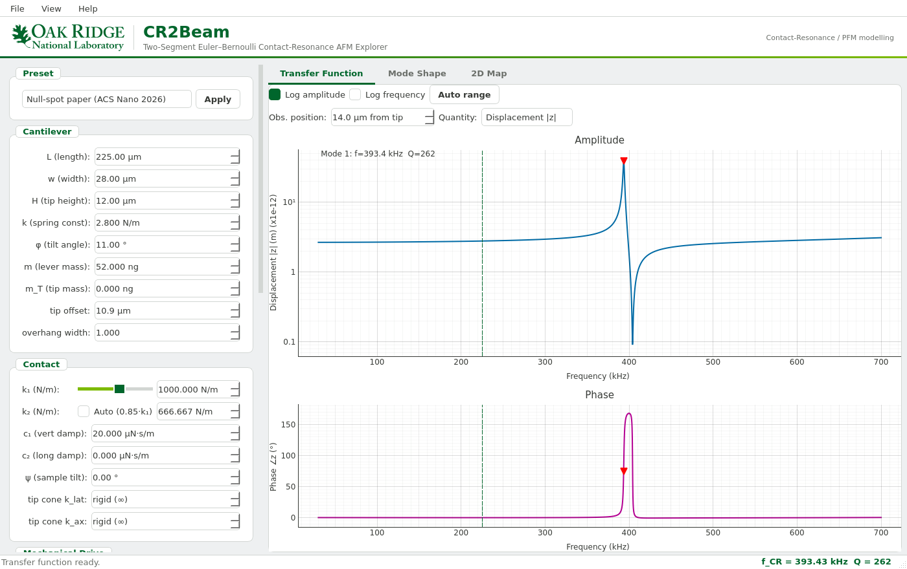

# EB-Solver-CResonance

**Euler–Bernoulli contact-resonance AFM / PFM cantilever solver, with the CR2Beam desktop GUI.**

`eb_cr_afm` simulates how an AFM cantilever moves when its tip is in contact
with a sample and the lever is driven by the sample (as in piezoresponse force
microscopy, PFM), by electrostatic forces, or both. It computes the full
complex shape of the lever, z(x), at every frequency, so you can see

- contact-resonance frequencies and quality factors and how they change with
  contact stiffness,
- what an optical-lever AFM (slope, z′) and an interferometer (displacement,
  z) would each measure at any point on the lever,
- where the **null spots** and **electrostatic blind spots** sit, the
  positions on the lever where the piezo signal or the electrostatic artefact
  vanishes.

The model is the analytical contact-resonance model of Bradler *et al.*
(2016, 2017), extended to a tilted lever whose tip is set back from the free
end (a **two-segment** beam). That set-back is what places the null spots on
the short overhang beyond the tip.

> **Please cite.** If you use this code, please cite
>
> M. Checa, H. Swicegood, R. Millan-Solsona, R. Bulanadi, J. Zhao, J. Lasseter,
> S. Jesse and L. Collins, **"Dynamics of Null and Electrostatic Blind Spots for
> Quantitative Piezoresponse Force Microscopy"**, *ACS Nano* (2026).
> [doi:10.1021/acsnano.6c14615](https://doi.org/10.1021/acsnano.6c14615)
> (preprint: [arXiv:2607.27486](https://arxiv.org/abs/2607.27486))
>
> A BibTeX entry is in [How to cite](#how-to-cite).



---

## Contents

1. [Installation](#1-installation)
2. [Your first simulation in the GUI](#2-your-first-simulation-in-the-gui)
3. [Your first simulation in Python](#3-your-first-simulation-in-python)
4. [Example notebooks](#4-example-notebooks)
5. [Parameters and units](#5-parameters-and-units)
6. [How the model works](#6-how-the-model-works)
7. [Optional: MCP tool server](#7-optional-mcp-tool-server)
8. [Running the tests](#8-running-the-tests)
9. [Troubleshooting](#9-troubleshooting)
10. [How to cite](#how-to-cite)

---

## 1. Installation

You need **Python 3.9 or newer** (3.10–3.12 recommended). If you do not have
Python yet, install it from [python.org](https://www.python.org/downloads/) or
use [Anaconda / Miniconda](https://docs.conda.io/en/latest/miniconda.html).

**Step 1: get the code.** Either download the ZIP from the green **Code**
button on GitHub and unzip it, or use git:

```bash
git clone https://github.com/Liambcollins/EB-Solver-CResonance.git
cd EB-Solver-CResonance
```

**Step 2: create a virtual environment (recommended).** This keeps the
packages for this project separate from everything else on your computer.

```bash
python -m venv .venv
```

Activate it. You need to do this every time you open a new terminal:

| System | Command |
|---|---|
| Windows (PowerShell) | `.venv\Scripts\Activate.ps1` |
| Windows (cmd) | `.venv\Scripts\activate.bat` |
| macOS / Linux | `source .venv/bin/activate` |

With conda instead: `conda create -n ebcr python=3.11` then `conda activate ebcr`.

**Step 3: install the package.** From the `EB-Solver-CResonance` folder:

```bash
python -m pip install --upgrade pip
python -m pip install -e ".[all]"
```

`[all]` installs the solver plus the GUI (PySide6, pyqtgraph), Jupyter and
pytest. If you only want the solver, use `python -m pip install -e .`. The
`-e` ("editable") flag means changes you make to the source take effect
immediately.

**Step 4: check that it worked.**

```bash
python -c "import eb_cr_afm; print('eb_cr_afm', eb_cr_afm.__version__, 'is ready')"
```

---

## 2. Your first simulation in the GUI

Start **CR2Beam** with either command:

```bash
cr2beam
# or, from the repository folder:
python launch_gui.py
```

A first transfer function is computed automatically for the default
Multi75-G probe. Then try the following.

1. **Look at the transfer function.** The *Transfer Function* tab shows
   amplitude and phase against frequency. The red triangle marks the fitted
   contact resonance; its frequency and Q are also shown in the bottom-right of
   the window. Use *Quantity* to switch between displacement |z| and slope
   |z′|, and *Obs. position* to choose where on the lever you "measure"
   (in µm from the free end).
2. **Change the contact stiffness.** Drag the **k₁** slider in the *Contact*
   box. The spectrum recomputes after a short pause, and the resonance moves to
   higher frequency as the contact gets stiffer.
3. **See how the lever bends.** Click on the amplitude plot, or drag the
   dashed cursor, to pick a frequency. The *Mode Shape* tab then shows z(x)
   and z′(x) along the lever at that frequency.
4. **Make a map.** In the *2D Map* tab choose a map type (contact stiffness
   vs frequency, position vs frequency, or the κ-map) and press **Compute**.
5. **Load the paper's parameters.** In *Preset* choose
   *Null-spot paper (ACS Nano 2026)* and press **Apply**. This loads the
   Multi75E-G probe with its 10.9 µm tip set-back, a 3 pm piezo drive and a
   3 V electrostatic drive.

Use **File → Save Params (JSON)** to store a set-up and **Load Params** to
restore it. **File → Export Figure** saves the current plot (PNG, SVG or PDF)
and **File → Export Data** saves the numbers (NPZ).

| Panel | What it shows |
|---|---|
| Transfer Function | Amplitude and phase vs frequency at the observation point; SHO peak fit |
| Mode Shape | z(x) and z′(x) along the lever at one frequency (amplitude, real or imaginary part) |
| 2D Map: stiffness | Response vs k₁ (log scale) and frequency |
| 2D Map: spatial | Response vs position x and frequency, showing how the mode shape evolves |
| 2D Map: κ-map | Resonance frequency, OBD slope and tip displacement vs dimensionless stiffness κ = k₁L³/EI for the first one or two modes |

---

## 3. Your first simulation in Python

The quickest start is the tour script:

```bash
python examples/getting_started.py
```

It prints

```text
Lever: L = 225 um, k = 2.8 N/m, tilt = 11 deg
Free resonance:       75.0 kHz  (Q = 236)
Contact resonance:   288.0 kHz  (Q = 905), k1 = 100 N/m
Contact resonance (paper preset, k1 = 1500 N/m): 366.8 kHz
D-NS   is -0.03 um from the tip (depth 8.7e-05)
D-ESBS is -6.93 um from the tip (depth 4.1e-04)
        (+ = toward the clamp, - = on the overhang past the tip)
```

and saves three figures to `results/`: free vs in-contact spectra, the mode
shape at resonance, and the near-tip null spot and blind spot.

The core of any simulation is four parameter objects and one function call:

```python
from eb_cr_afm import default_params_multi75, frequency_sweep, sho_analysis

# 1. Parameters: cantilever, contact, excitation (drive) and solver options
cant, contact, exc, opts = default_params_multi75()   # BudgetSensors Multi75-G
contact.k1 = 500.0                                    # stiffer sample, N/m
contact.k2 = 0.85 * contact.k1                        # lateral contact stiffness

# 2. Sweep the drive frequency (opts.f_start to opts.f_stop, in Hz)
sweep = frequency_sweep(cant, contact, exc, opts)

# 3. Fit the resonance peaks of the slope signal (what an optical lever sees)
modes = sho_analysis(sweep, quantity="slope")
best = max(modes, key=lambda m: m["A_res"])
print(f"Contact resonance: {best['f_res']/1e3:.1f} kHz, Q = {best['Q']:.0f}")
```

`frequency_sweep` returns a dictionary:

```python
sweep["freqs"]             # frequencies [Hz]
sweep["amplitudes_disp"]   # |z(obs_x)|   [m]
sweep["phases_disp"]       # phase of z   [degrees]
sweep["amplitudes_slope"]  # |z'(obs_x)|  [rad]
sweep["phases_slope"]      # phase of z'  [degrees]
sweep["results"]           # per-frequency solutions, incl. the full z(x)
```

By default the observation point `obs_x` is the tip contact. Pass
`frequency_sweep(..., obs_x=...)` (metres from the clamp) to observe
elsewhere. For a single frequency, `solve_single_frequency(f, cant, contact,
exc, opts)` returns the whole lever shape: `r["x"]`, `r["z"]`, `r["zp"]`
(complex arrays).

Three presets are included:

| Function | Probe / use |
|---|---|
| `default_params_multi75()` | BudgetSensors Multi75-G, tip at the free end; a good place to start |
| `default_params()` | Table I of Bradler *et al.* (2016), for comparison with that paper |
| `default_params_null_spot_paper()` | Multi75E-G with a 10.9 µm tip set-back, as used in Checa *et al.* (2026) |

---

## 4. Example notebooks

Start Jupyter from the repository folder and open the `examples/` folder:

```bash
jupyter notebook examples/
```

The notebooks are meant to be read roughly in order. 01–03 are the best
introduction.

| Notebook | What you will learn |
|---|---|
| [`01_multi75_quickstart`](examples/01_multi75_quickstart.ipynb) | Free vs in-contact sweeps, SHO fitting, the shape factor |
| [`02_contact_stiffness_sweep`](examples/02_contact_stiffness_sweep.ipynb) | Resonance frequency and Q vs k₁, 2D amplitude map, modulus inversion |
| [`03_spatial_profiles_and_spectra`](examples/03_spatial_profiles_and_spectra.ipynb) | Mode shapes and 2D z(x, f) spectra |
| [`04_analytical_vs_numerical`](examples/04_analytical_vs_numerical.ipynb) | Checks the analytical solver against the independent `solve_bvp` solver |
| [`05_analytical_conditioning_diagnostics`](examples/05_analytical_conditioning_diagnostics.ipynb) | Numerical conditioning of the analytical solver |
| [`06_electrostatic_force_profiles_and_spectra`](examples/06_electrostatic_force_profiles_and_spectra.ipynb) | The distributed electrostatic load and the response it drives |
| [`07_node_vs_electrostatic_blind_spot`](examples/07_node_vs_electrostatic_blind_spot.ipynb) | Two-segment model: null spot vs electrostatic blind spot on the overhang |
| [`09_lateral_stiffness_and_node_branches`](examples/09_lateral_stiffness_and_node_branches.ipynb) | How the lateral contact stiffness k₂ moves the near-tip nulls |
| [`10_manuscript_figures`](examples/10_manuscript_figures.ipynb) | Regenerates every Euler–Bernoulli figure in the ACS Nano paper and SI (takes several minutes) |

Plots in notebooks 01–07 use Plotly, so you can hover, zoom and pan. Figures
and interactive HTML copies are written to `results/`.

Two short scripts are also included: `examples/example_table1_simulation.py`
reproduces the Table I transfer function of Bradler *et al.* (2016), and
`examples/example_2d_spectra.py` makes a 2D spatial–frequency map.

---

## 5. Parameters and units

**All inputs are SI units**: metres, kilograms, newtons, seconds, hertz,
radians. (The GUI shows friendlier units such as µm, ng, kHz and degrees and
converts them for you.)

### `CantileverParams`

| Field | Unit | Meaning |
|---|---|---|
| `L` | m | Lever length |
| `w` | m | Lever width (used for the electrostatic load) |
| `H` | m | Tip height |
| `k` | N/m | Static spring constant; sets the flexural rigidity EI = kL³/3 |
| `m` | kg | Mass of the lever |
| `mT` | kg | Tip mass (acts at H/4) |
| `phi` | rad | Tilt of the lever relative to the sample |
| `tip_offset` | m | How far the tip sits back from the free end. `0` = tip at the end (original Bradler model); `> 0` activates the two-segment model |
| `overhang_width_ratio` | – | Electrostatic width of the overhang as a fraction of `w` (1 = full width) |

### `ContactParams`

| Field | Unit | Meaning |
|---|---|---|
| `k1` | N/m | Vertical (normal) contact stiffness |
| `k2` | N/m | Lateral (along-the-lever) contact stiffness; 0.85·k₁ is a common choice, 0 is frictionless |
| `c1`, `c2` | N·s/m | Vertical and lateral contact damping |
| `psi` | rad | Local sample tilt |
| `k_cone_lat`, `k_cone_ax` | N/m | Stiffness of an elastic tip cone; `inf` (default) is a rigid tip |

### `ExcitationParams`

| Field | Unit | Meaning |
|---|---|---|
| `d1`, `d2` | m | Vertical and lateral sample-displacement drive (the piezo signal) |
| `V_AC` | V | AC bias amplitude |
| `delta_V` | V | DC potential difference (applied DC + surface potential) |
| `eps_r` | – | Relative permittivity of the gap (air = 1) |
| `use_distributed_load` | bool | Include the electrostatic force acting along the whole lever |
| `use_f0`, `f0` | –, N | Include a point force `f0` at the tip |
| `bias_coupled_f0`, `capacitance_gradient` | –, F/m | Add a tip force ½·(dC/dz)·(ΔV + V_AC)² |
| `lift_height` | m | Raise the whole lever above the surface (0 = contact) |

### `SolverOptions`

| Field | Default | Meaning |
|---|---|---|
| `f_start`, `f_stop`, `f_step` | 300 kHz, 400 kHz, 500 Hz | Frequency sweep [Hz] |
| `n_points` | 500 | Grid points along the lever |
| `g` | 20 000 1/s | Air damping η (Bradler Table I value) |
| `method` | `"analytical"` | `"analytical"` (fast, closed form) or `"bvp"` (scipy `solve_bvp`, slower, for cross-checks) |

The presets set their own sweep range and damping.

---

## 6. How the model works

The lever obeys the Euler–Bernoulli beam equation with air damping,

```text
d⁴z/dx⁴ = α⁴ z(x) + q(x)/EI,        α⁴ = (m / (EI·L)) · (ω² − i g ω)
```

where q(x) is the distributed electrostatic load. The tip couples the lever
to the sample through vertical and lateral springs and dashpots (k₁, k₂, c₁,
c₂), including the tip height H, the tip mass and the lever tilt φ (Bradler
*et al.*, 2016, Eqs. 1–18).

- **Tip at the free end (`tip_offset = 0`).** The tip–sample forces are
  boundary conditions at x = L. This is exactly the original Bradler model.
- **Tip set back from the end (`tip_offset > 0`).** The lever is split into
  a clamped segment [0, x_c] and a free overhang [x_c, L]. The tip forces act
  as jumps in moment and shear at x_c, the true free end satisfies
  z″(L) = z‴(L) = 0, and the electrostatic load acts on both segments. The
  solution is closed form (a 6×6 linear system) and reduces exactly to the
  Bradler model as the set-back goes to zero.

Both cases are solved analytically by default. The `"bvp"` method solves the
same problem numerically with `scipy.integrate.solve_bvp` as an independent
check. The tests show the two agree.

The derivation, the validation, and why the overhang and tilt control the
near-tip nulls are in **[docs/model.md](docs/model.md)**.

---

## 7. Optional: MCP tool server

The `server/` folder exposes the solver as a set of tools over the
[Model Context Protocol](https://modelcontextprotocol.io) (JSON-RPC over
stdio), so that automated-experiment and workflow software can call it. Most
users can ignore it.

```bash
python -m server.main
```

Tools: `list_public_api`, `solve_frequency_response`,
`analyze_frequency_sweep` and `compute_spatial_spectra_map`. Large arrays can
be written to `.npz` instead of being returned inline. Example request:

```json
{"jsonrpc": "2.0", "id": 1, "method": "tools/call",
 "params": {"name": "analyze_frequency_sweep",
            "arguments": {"solver_options": {"f_start": 330000.0, "f_stop": 360000.0,
                                             "f_step": 500.0, "method": "analytical"}}}}
```

---

## 8. Running the tests

```bash
python -m pytest
```

The tests check the solver against limiting cases (free and pinned beams, the
Δx → 0 limit of the two-segment model, analytical vs BVP agreement, the
elastic tip, lift height) and the MCP server. They take about a minute.

---

## 9. Troubleshooting

| Problem | Fix |
|---|---|
| `ModuleNotFoundError: No module named 'eb_cr_afm'` | Activate your virtual environment and run `python -m pip install -e .` from the repository folder. |
| Works in the terminal but not in Jupyter | Jupyter is using a different Python. Run `python -m pip install ipykernel` then `python -m ipykernel install --user --name ebcr` in your environment, and choose the **ebcr** kernel in Jupyter. |
| `cr2beam` / GUI says PySide6 is missing | `python -m pip install "PySide6>=6.5" "pyqtgraph>=0.13"` |
| Linux: `libEGL.so.1` or `xcb` plugin errors when starting the GUI | Install the system OpenGL/X libraries, e.g. `sudo apt install libegl1 libxkbcommon-x11-0 libxcb-cursor0`. |
| The fitted Q is marked with `*` | The peak is narrower than the frequency step. Reduce `f_step` (or the GUI *f step*) around the resonance. |
| A sweep finds no resonance | Check that the range `f_start`–`f_stop` contains it. Stiffer contacts push the resonance up, towards ~4.4× the free resonance for a pinned tip. |

---

## Repository layout

```text
src/eb_cr_afm/          the Python package
  params.py             parameter dataclasses
  solver.py             analytical and BVP solvers, frequency_sweep, sho_analysis
  spectra.py            2D maps: stiffness sweeps, spatial spectra, κ-map
  plotting.py           matplotlib figures
  interactive.py        Plotly figures
  gui/                  CR2Beam desktop application
examples/               getting_started.py and the Jupyter notebooks
docs/model.md           model derivation and physics notes
server/                 optional MCP tool server
tests/                  pytest suite
results/                output folder for examples (initially empty)
launch_gui.py           starts CR2Beam without installing
```

---

## How to cite

If this software contributes to your work, please cite the paper:

```bibtex
@article{Checa2026NullSpots,
  title   = {Dynamics of Null and Electrostatic Blind Spots for Quantitative
             Piezoresponse Force Microscopy},
  author  = {Checa, Marti and Swicegood, Holland and Millan-Solsona, Ruben and
             Bulanadi, Ralph and Zhao, Jerry and Lasseter, Jack and
             Jesse, Stephen and Collins, Liam},
  journal = {ACS Nano},
  year    = {2026},
  doi     = {10.1021/acsnano.6c14615},
  url     = {https://doi.org/10.1021/acsnano.6c14615},
  eprint  = {2607.27486},
  archivePrefix = {arXiv}
}
```

The underlying contact-resonance model is from

- S. Bradler, S. R. Kachel, A. Schirmeisen and B. Roling, *J. Appl. Phys.*
  **120**, 165107 (2016). [doi:10.1063/1.4964942](https://doi.org/10.1063/1.4964942)
- S. Bradler, A. Schirmeisen and B. Roling, *J. Appl. Phys.* **122**, 065106
  (2017). [doi:10.1063/1.4998435](https://doi.org/10.1063/1.4998435)

GitHub's **Cite this repository** button (from `CITATION.cff`) gives the same
information.

## Acknowledgements

This work was carried out at the Center for Nanophase Materials Sciences
(CNMS), a US Department of Energy, Office of Science User Facility at Oak
Ridge National Laboratory.

## License

MIT. See [LICENSE](LICENSE).
